<!-- Generated by scripts/build.ts in Ved0915/Ved0915. Edit the data there, not this file. -->

<a href="https://www.balanceview.in/it-services">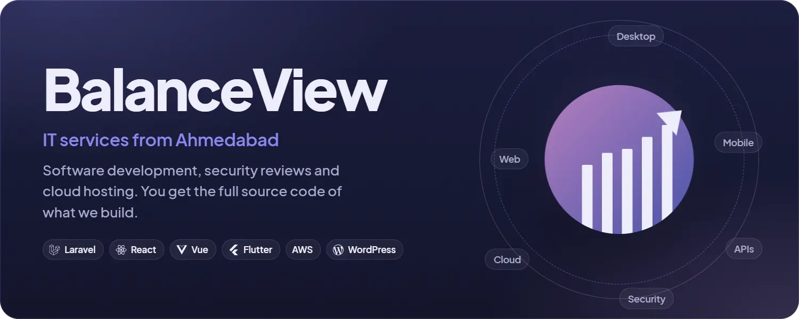</a>

BalanceView builds websites, web apps, APIs, mobile apps and business software for companies across India, from Ahmedabad. You get the full source code of what we build.

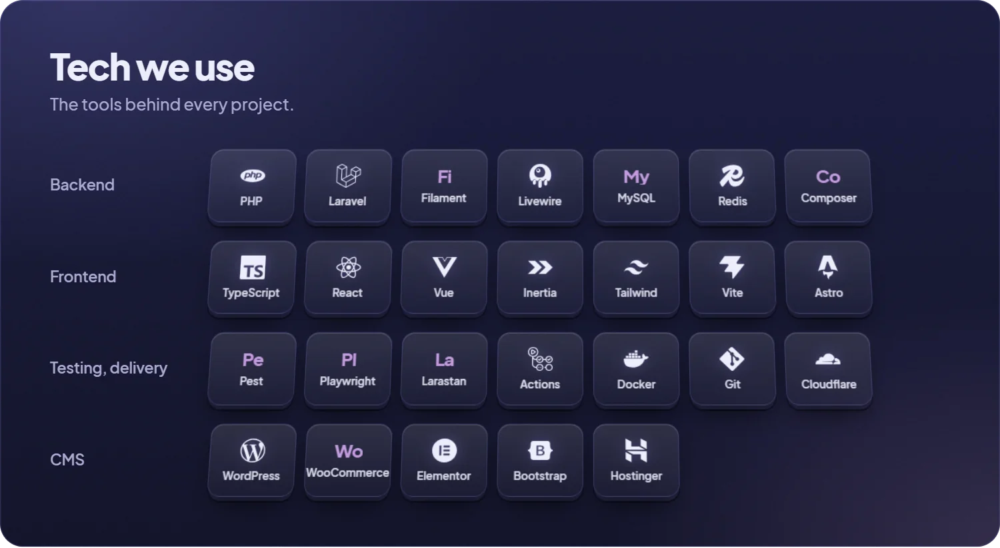

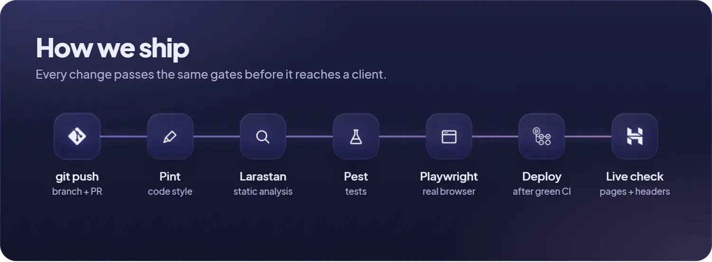

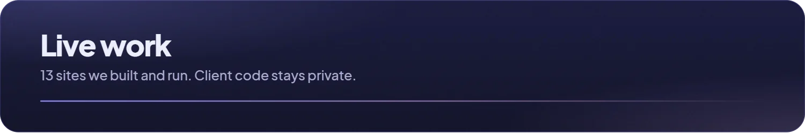

<a href="https://www.balanceview.in">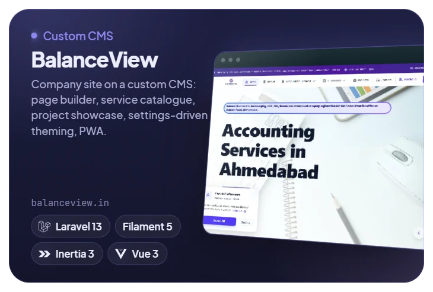</a><a href="https://www.panchalinterior.in">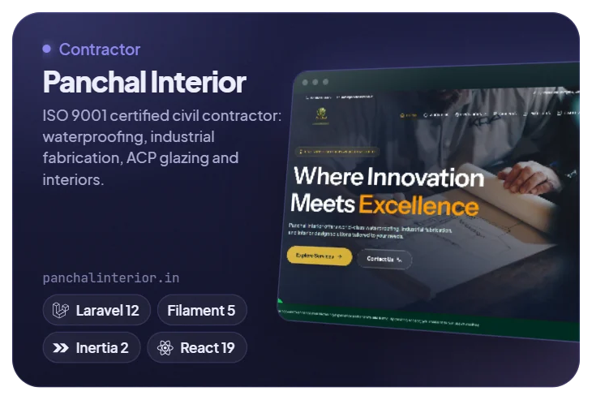</a> <a href="https://superfast.balanceview.in">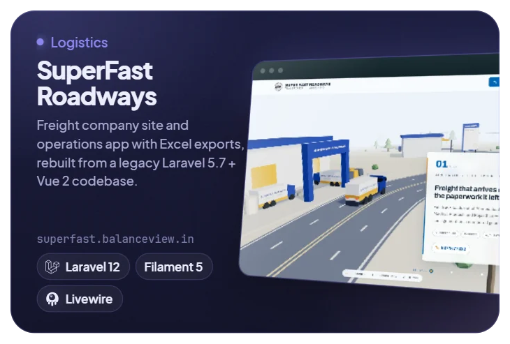</a><a href="https://hdstudio.co.in">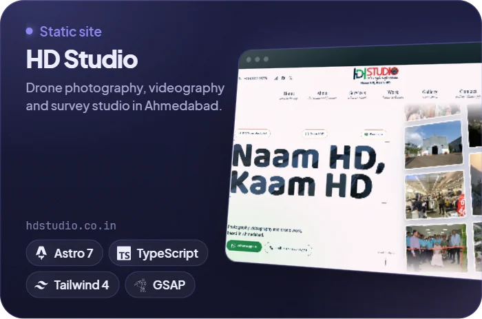</a> <a href="https://grocerystore.balanceview.in">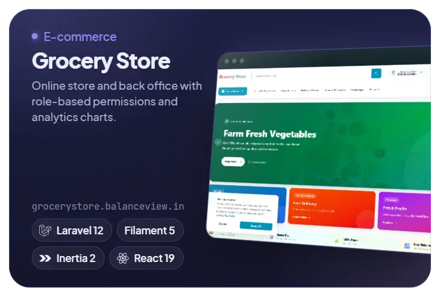</a><a href="https://radiocodess.com">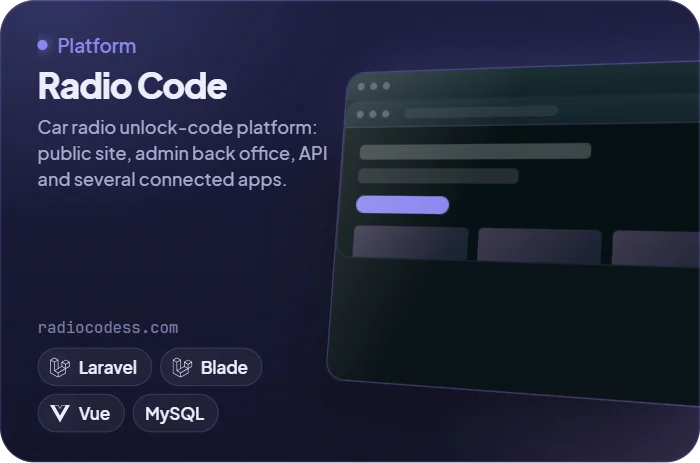</a>

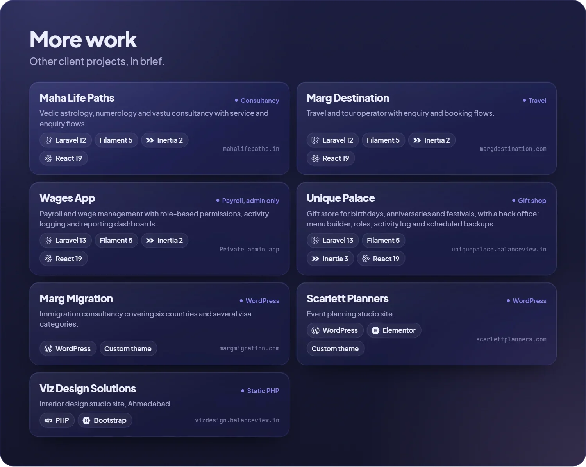

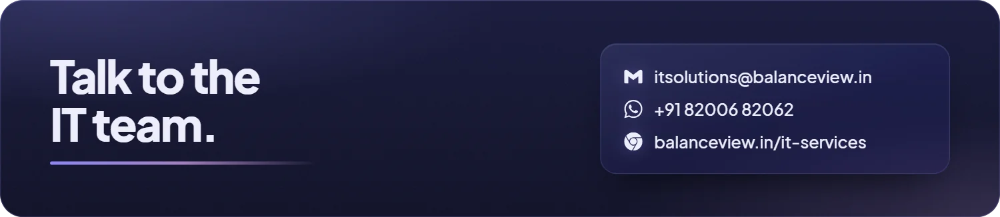
